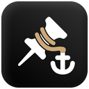

# Tab Anchor

A browser extension which solves the problem that everyone faces (hopefully).

> You pin a tab. You go and do your browsing. You come back to the pinned tab.
> You realise you've been navigating all over in that pinned tab.
> You loose your pin.

The above scenario is something that I've done alot of times, so I wrote Tab Anchor.

# How it works
It stores and tracks each pinned tab you have. A pinned tab can have 3 modes.

Strict - You cannot navigate away from that specific url

Loose - You can navigate around within that domain

Free - You can do whatever. Default pinned tab behaviour

You can select a default mode, or override the mode per pinned tab. It's all tracked

# Installation
I have not released this officially (yet), so you have to side load it.
